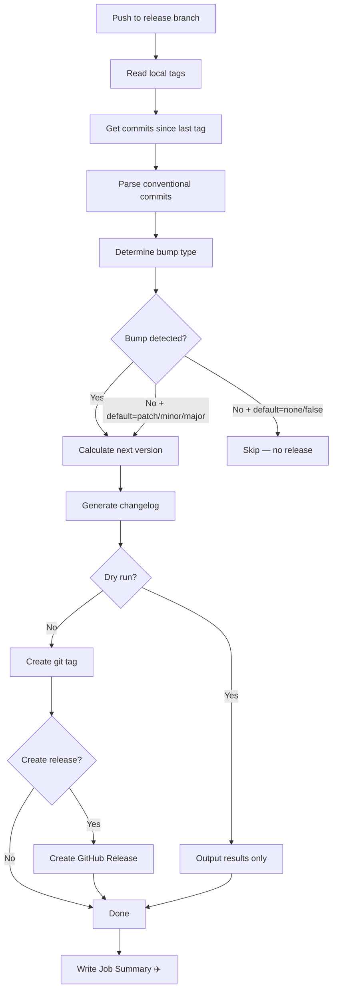

<p align="center">
  <h1 align="center">✈️ Release Pilot</h1>
  <p align="center">
    <strong>The definitive GitHub Action for semantic versioning, tagging, changelog generation, and releases.</strong>
  </p>
  <p align="center">
    Powered by <a href="https://www.conventionalcommits.org/">Conventional Commits</a> · Zero config · One action does it all
  </p>
</p>

---

## Why Release Pilot?

Most release workflows require chaining 3+ actions together, configuring complex tools, or relying on deprecated projects. **Release Pilot** replaces all of that with a single, modern action:

| Feature | Release Pilot | Typical alternatives |
|---------|:---:|:---:|
| Conventional Commits parsing | ✅ Native | 🔗 Often an external dep |
| Version calculation | ✅ Built-in | ✅ |
| Changelog generation | ✅ Built-in | ⚠️ Often a separate action |
| GitHub Release creation | ✅ Built-in | ⚠️ Often a separate action |
| Job Summary | ✅ Built-in | ⚠️ Rare |
| Breaking change detection (`!` + footer) | ✅ Both | ⚠️ Varies |
| Pre-release support | ✅ | ⚠️ Varies |
| Floating major/minor tags (`v2`, `v2.3`) | ✅ Built-in | ⚠️ Often manual scripts |
| Node.js 24 + ESM | ✅ | ⚠️ Varies |
| Minimal dependencies* | ✅ | ⚠️ Varies |

<sub>* Only uses official `@actions/*` packages and `semver`.</sub>

## Quick Start

```yaml
name: Release
on:
  push:
    branches: [main]

permissions:
  contents: write

# Serialize releases so two pushes never race to create the same tag
concurrency:
  group: release
  cancel-in-progress: false

jobs:
  release:
    runs-on: ubuntu-latest
    steps:
      - uses: actions/checkout@v7
        with:
          fetch-depth: 0

      - name: ✈️ Release Pilot
        uses: ranarn/release-pilot@v1
        with:
          token: ${{ secrets.GITHUB_TOKEN }}
```

That's it. **Zero config.** Release Pilot will:

1. Parse all commits since the last tag using Conventional Commits
2. Determine the next SemVer version
3. Create an annotated git tag
4. Output the version, tag, and changelog

## Examples

### Tag + GitHub Release

```yaml
- name: ✈️ Release Pilot
  uses: ranarn/release-pilot@v1
  with:
    token: ${{ secrets.GITHUB_TOKEN }}
    create-release: true
    release-title: 'Release {{tag}}'
```

### Draft Release (Review Before Publishing)

Create releases as drafts so you can review, edit, or batch multiple releases before they go public:

```yaml
- name: ✈️ Release Pilot
  uses: ranarn/release-pilot@v1
  with:
    token: ${{ secrets.GITHUB_TOKEN }}
    create-release: true
    release-draft: true
    release-title: 'Release {{tag}}'
```

> Drafts are invisible to users until you publish them. Go to **Releases → Edit draft → Publish release** when you're ready. The Conventional Commits changelog is already written for you.

### Tag + Use Version Downstream

```yaml
- name: ✈️ Release Pilot
  id: release
  uses: ranarn/release-pilot@v1
  with:
    token: ${{ secrets.GITHUB_TOKEN }}

- name: 🐳 Build Docker Image
  if: steps.release.outputs.released == 'true'
  run: |
    docker build -t myapp:${{ steps.release.outputs.version }} .
    docker push myapp:${{ steps.release.outputs.version }}
```

### Pre-release from Feature Branches

```yaml
- name: ✈️ Release Pilot
  uses: ranarn/release-pilot@v1
  with:
    token: ${{ secrets.GITHUB_TOKEN }}
    prerelease: true
    prerelease-suffix: beta   # omit to use the branch name as identifier
```

> When `prerelease-suffix` is omitted, the branch name is sanitised and used as the identifier. For example, a branch named `feature/my-api` produces `1.2.0-feature-my-api.0`, `1.2.0-feature-my-api.1`, etc.
>
> Prerelease mode runs on any branch, but pull request runs are always skipped.

### Dry Run (CI Validation)

```yaml
- name: ✈️ Preview Release
  uses: ranarn/release-pilot@v1
  with:
    token: ${{ secrets.GITHUB_TOKEN }}
    dry-run: true
```

### Custom Release Rules

```yaml
- name: ✈️ Release Pilot
  uses: ranarn/release-pilot@v1
  with:
    token: ${{ secrets.GITHUB_TOKEN }}
    custom-rules: 'hotfix:patch:🔥 Hotfixes,improvement:minor:💡 Improvements'
```

### Floating Major/Minor Tags (GitHub Action Style)

Automatically maintain `v2` → latest `v2.x.x` and `v2.3` → latest `v2.3.x` tags,
just like `actions/checkout@v7` does:

```yaml
- name: ✈️ Release Pilot
  uses: ranarn/release-pilot@v1
  with:
    token: ${{ secrets.GITHUB_TOKEN }}
    major-tag: true    # v2 always points to latest v2.x.x
    minor-tag: true    # v2.3 always points to latest v2.3.x
```

> When you release `v2.3.1`, Release Pilot creates three tags:
> - `v2.3.1` — the exact version (immutable)
> - `v2.3` — floats to latest `v2.3.x` (force-updated)
> - `v2` — floats to latest `v2.x.x` (force-updated)

## 📥 Inputs

| Input | Description | Default |
|-------|-------------|---------|
| `token` | GitHub token used to create the GitHub Release. Tags are pushed with the git credentials from `actions/checkout` (see [Requirements](#requirements)). | `${{ github.token }}` |
| `prefix` | Tag prefix | `v` |
| `default-bump` | Bump applied when no commit maps to a bump — including pushes with only `docs:`, `chore:`, `ci:` etc. or non-conventional commits. One of `patch`, `minor`, `major`, `none`, `false`. Both `none` and `false` skip the release in that case; `none` is recommended for libraries and actions. | `patch` |
| `initial-version` | Starting version when no tags exist. Must be valid semver. | `0.1.0` |
| `prerelease` | Enable prerelease mode. Runs on any branch (ignores `branches`); pull requests are still skipped. | `false` |
| `prerelease-suffix` | Prerelease identifier (e.g., `beta`) | Branch name |
| `branches` | Comma-separated release branch patterns (regex, anchored to full name). Ignored when `prerelease` is `true`. | `main,master` |
| `create-release` | Create a GitHub Release | `false` |
| `release-draft` | Create release as draft | `false` |
| `release-title` | Release title template (`{{version}}`, `{{tag}}`) | `{{tag}}` |
| `annotated` | Create annotated tags | `true` |
| `commit-sha` | Override the commit SHA. Must be a full 40-character hex SHA. | `GITHUB_SHA` |
| `dry-run` | Calculate without creating anything | `false` |
| `custom-rules` | Custom commit type rules | `''` |
| `include-body-in-changelog` | Include commit body in changelog | `false` |
| `major-tag` | Create/update floating major tag (`v2` → latest `v2.x.x`) | `false` |
| `minor-tag` | Create/update floating minor tag (`v2.3` → latest `v2.3.x`) | `false` |

## 📤 Outputs

| Output | Description | Set when | Example |
|--------|-------------|----------|---------|
| `version` | New version without prefix | A version was calculated (also in dry run) | `1.2.3` |
| `tag` | New tag with prefix | A version was calculated (also in dry run) | `v1.2.3` |
| `previous-version` | Previous version | A previous tag exists — not on pull request or non-release-branch skips | `1.2.2` |
| `previous-tag` | Previous tag | Same as `previous-version` | `v1.2.2` |
| `bump` | Bump type applied | Always | `minor` |
| `changelog` | Generated changelog (markdown) | A version was calculated (also in dry run) | See below |
| `release-url` | URL to GitHub Release | A GitHub Release was created | `https://...` |
| `released` | Whether a new version tag was created. `true` regardless of whether a GitHub Release was made — check `release-url` for that. | Always | `true` |

Outputs that are not set read as an empty string, so guard downstream steps with `if: steps.<id>.outputs.released == 'true'`.

## Conventional Commits

Release Pilot follows the [Conventional Commits](https://www.conventionalcommits.org/) specification:

```
<type>[optional scope][!]: <description>

[optional body]

[optional footer(s)]
```

### Default Commit Types → Bumps

| Type | Bump | Changelog Section |
|------|------|-------------------|
| `feat` | **minor** | 🚀 Features |
| `fix` | **patch** | 🐛 Bug Fixes |
| `perf` | **patch** | ⚡ Performance |
| `revert` | **patch** | ⏪ Reverts |
| `docs` | none | 📚 Documentation |
| `style` | none | 💄 Styling |
| `refactor` | none | ♻️ Refactoring |
| `test` | none | ✅ Tests |
| `build` | none | 📦 Build |
| `ci` | none | 🔧 CI/CD |
| `chore` | none | 🧹 Chores |

### Breaking Changes → `major`

Breaking changes are detected via:

```
feat!: remove deprecated API
```

or:

```
feat: refactor authentication

BREAKING CHANGE: The auth token format has changed.
```

This also applies below 1.0.0: a breaking change during `0.x` releases `1.0.0`.

## How It Works



## Requirements

- **Checkout with full history:** Always use `fetch-depth: 0` in your checkout step. A shallow clone will cause the action to fail immediately with a clear error message.
- **Write permissions:** The job needs `contents: write`.
- **Checkout credentials push the tags:** Tags (including floating tags) are pushed with `git push`, using the credentials `actions/checkout` persists. Keep `persist-credentials` at its default (`true`). To push tags as a different identity (e.g. a PAT, so tag pushes trigger other workflows), pass that token to `actions/checkout` via its `token` input. The `token` input of Release Pilot is used for creating the GitHub Release.
- **Node.js 24:** This action runs on Node.js 24 (handled automatically by GitHub Actions).

## Notes

### `[skip ci]` commits are excluded

Commits containing `[skip ci]` (case-insensitive; also `[skip-ci]` and `[skip_ci]`) anywhere in the message — subject or body — are excluded from bump detection and the changelog.

> **Squash merges:** GitHub's default squash commit body lists every commit in the PR. If any of them carried `[skip ci]` (e.g. a bot commit), the squashed commit inherits it: GitHub skips the workflow, and Release Pilot ignores the commit. Edit the squash message, or keep the marker out of PR commits.

### Re-runs recover a missing release

If a run pushed the tag but failed before creating the GitHub Release, re-running it (or the next run with no new commits) creates the missing release for the latest tag, with the changelog since the tag before it. This only happens when `create-release` is `true`; existing releases, including drafts, are left untouched.

### Branch patterns are fully anchored regex

Each pattern in `branches` is wrapped as `^pattern$` before matching. Use `release/.*` to match all branches starting with `release/`. Invalid regex patterns fall back to exact string comparison.

### Floating tags use force-push

`major-tag` and `minor-tag` are force-updated on each release. This is intentional — it is the standard GitHub Actions versioning pattern (`actions/checkout@v7` does the same thing).

## Changelog

See [Releases](https://github.com/ranarn/release-pilot/releases) for the full version history and changelogs.

## License

MIT © Jonas Ranerfors
